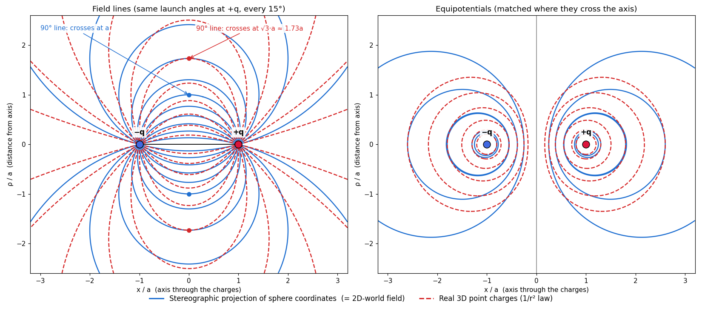

# Coulomb's Seesaw

Exploring whether electric field lines and equipotentials of two point charges can be understood as
stereographic projections of coordinates on a higher-dimensional sphere — with an eventual 4D "seesaw"
picture of why charges behave the way they do.

## Background

The idea for this came from the stereographic projections shown in this [quaternion visualization video](https://www.youtube.com/watch?v=d4EgbgTm0Bg) by 3Blue1Brown. 
> In the video, a sphere with lines of latitude and longitude is also shown projected stereographically into a flat plane, and then the sphere is rotated to demonstrate what 3D rotation might look like in lower dimensions. When the sphere is rotated so that both poles are at finite distance from the origin in the flat plane ([14:21](https://youtu.be/d4EgbgTm0Bg?si=vgO1-CyXRW5Bd7y6&t=861)), the resulting lines of longitude look suspiciously like electric field lines leaving a source and entering a sink.

The idea, then, was to see if electric field lines could be constructed by the stereographic projection of some sphere living in the standard dimensions plus one extra spatial dimension.

It was quickly discovered that, while the construction could work in two dimensions, a simple stereographic projection of lines of longitude would not map onto the electric field lines as established by the rules of electrostatics in three dimensions.



However, it is possible to recreate the field behavior for three dimensions by applying a weighted push of those longitudinal lines towards the point on the sphere which gets projected to infinity.
  - This weighted push does not come from thin air - it lines up with pre-existing classical work on potential functions and inversive geometry. For a more technical description, please see the [technical details document](TechnicalDetails.md).

The goal of this app is to interactively visualize this construction/pseudo-stereographic projection.

## Files

| File | Purpose |
|------|---------|
| [src/main.ts](./src/main.ts) | Browser controls, linked probe, and live verification |
| [src/views.ts](./src/views.ts) | Both Three.js scenes and the 2D/3D construction camera |
| [src/physics.ts](./src/physics.ts) | Weighted potential, analytic gradient, Coulomb reference, and RK4 field-line tracing |
| [src/physics.test.ts](./src/physics.test.ts) | Independent identity, gradient, and trajectory tests |
| [compare_fields.py](./compare_fields.py) | Plots projected sphere coordinates vs. real 3D point-charge field lines and equipotentials |
| [compare_fields.png](./compare_fields.png) | Output of the above |
| [verify_seesaw.py](./verify_seesaw.py) | Numerically verifies the unequal-charge "seesaw" identity (below) |

Run with `python compare_fields.py` / `python verify_seesaw.py` (needs `numpy`, `matplotlib`).

## Interactive web app

Use Node.js 22 LTS or newer supported LTS, then:

```powershell
npm install
npm run dev
```

Open the localhost URL printed by Vite. All rendering and calculations run locally in the
browser; no Python backend or external assets are needed.

```powershell
npm test
npm run build
npm run preview
```

Pushes to `main` deploy to GitHub Pages via `.github/workflows/deploy.yml` (set the repository's
**Settings → Pages → Source** to **GitHub Actions**).

The two views fill the window. Everything else lives in two drawers opened from the top bar
(the charge summary chip also opens **Settings**); `Esc` closes them.

- **Settings:** charge magnitudes (0.25 to 4), the second charge's sign, and separation (0.5 to 6), applied on change, plus
  presets. Also line density, tracing model, slice azimuth, probe position, and on/off switches
  for every layer: lifted lines and projection rays (construction); field lines, potential
  color, equipotential contours, and 3D context (physical). Coulomb's constant is 1.
- **Details:** live verification, seesaw geometry (O, R, d2/d1, pole-axis tilt a), the
  escaping-line count against Gauss's law, probe readouts, and a short explanation.
- **Construction view:** the sphere centered on the fulcrum, the pole axis joining the two lifted
  charges, and projection rays from N. Lines are traced **on the sphere** as steepest paths of
  $G_t = w^t F$ ([Technical Details §4](TechnicalDetails.md#4-from-the-weighted-potential-to-field-lines)). Grey reference curves are the unweighted longitudes of $F$ ($t=0$); the
  **Weight applied** slider and ▶ button bend them into the real lines ($t=1$). Charge-to-charge
  lines are mint; lines reaching N (infinity) are violet. Curves are drawn on the sphere only; the
  physical view shows their projections. Only $t=0$ and $t=1$ are physical; intermediate values are an
  illustrative interpolation. The **2D** toggle gives an orthographic side elevation.
- **Physical view:** the actual 3D point-charge field in a rotatable axial cross-section, with an
  optional overlay of the projected longitudes (circles through both charges).
- **Field lines:** traced with RK4 from the **stronger** charge only, uniform in $\cos\theta$, so each
  line carries equal axisymmetric flux. The weaker charge therefore receives
  $|q_\text{weak}|/|q_\text{strong}|$ of them and the rest escape. Escaping lines are followed to
  200 separations (step size grows with distance), far enough that their lift lies next to N.
- **Verification:** independently evaluates direct Coulomb and weighted-sphere potential and field
  vectors at 180 deterministic points with all three physical coordinates nonzero. The tracing
  model selector switches between these two implementations.

The displayed sphere is the $S^2$ slice of $S^3$ lying over the world plane $z=0$, which is
sufficient here because the charges sit on that plane. Vertical height is the extra
coordinate. Charge **volume** scales with magnitude, but the sources remain ideal point charges.
The physical view clips lines to its plotted square; leaving the square is not the same as
escaping (balanced pairs have large loops that return). The second charge can be opposite or
like-signed (Settings ? Charges); like pairs seed lines from both charges in proportion to size.


## Related work
An automated literature search (Nov 2026) found the following related work:

**Closest match: Maxwell / Kelvin's zero-potential sphere.**
- In Maxwell's *Treatise*, Vol. 1, Ch. XI, Art. 156 ([Wikisource](https://en.wikisource.org/wiki/A_Treatise_on_Electricity_and_Magnetism/Part_I/Chapter_XI)),
  credited to W. Thomson (Kelvin), *Camb. & Dublin Math. J.* (1848), opposite charges $e_1, e_2$ have a
  zero-potential sphere centered at C on AB *produced*, with $AC:BC = e_1^2:e_2^2$ and radius
  $AB\,e_1e_2/|e_1^2-e_2^2|$.
- Our fulcrum divides AB in the same ratio $q_1^2:q_2^2$, but *internally*, with radius
  $L\,q_1q_2/(q_1^2+q_2^2)$. The two centers are harmonic conjugates.
- Maxwell's sphere is the projection of the $S^3$ "equator" between the antipodal poles, where
  $F = 0$, so it is the $V=0$ surface. Checked numerically to $10^{-15}$.

**Classical ingredients:**
- **Inversion, Kelvin transform, and images:** W. Thomson (1845–48) and Liouville (1847); Maxwell, *Treatise* Ch. XI, Arts. 155–174.
  A modern pedagogical treatment: Amaral, Ventura & Lemos, "Kelvin transformation and inverse
  multipoles in electrostatics," *Eur. J. Phys.* 38, 015202 (2017), [arXiv:1611.05942](https://arxiv.org/abs/1611.05942).
- **Bispherical coordinates and R-separation:** the weight is the R-separation prefactor $\sqrt{\cosh\tau-\cos\sigma}$.
  - Morse & Feshbach, *Methods of Theoretical Physics* (1953), pp. 665–666, 1298–1301.
  - Moon & Spencer, *Field Theory Handbook* (1988), pp. 110–112.
  - G. B. Jeffery, *Proc. R. Soc. A* 87, 109 (1912), [doi:10.1098/rspa.1912.0011](https://doi.org/10.1098/rspa.1912.0011) (two-sphere problems).
- **Conformal symmetry of Laplace's equation:**
  - M. Bôcher, *Ueber die Reihenentwickelungen der Potentialtheorie* (Teubner, 1894), introducing pentaspherical coordinates.
  - W. Miller Jr., *Symmetry and Separation of Variables* (Addison-Wesley, 1977).
- **Conformal Laplacian and stereographic projection:** J. M. Lee & T. H. Parker, "The Yamabe problem,"
  *Bull. AMS* 17, 37 (1987). 
    - Cited only for background, not the Yamabe problem itself.
- **Same geometry, quantum setting:** V. Fock, *Z. Phys.* 98, 145 (1935). Fock stereographically projects
  hydrogen's momentum space onto $S^3$ with a weight factor, revealing its SO(4) symmetry. See also
  Meremianin & Rost, *J. Phys. A* 39, 12427 (2006), [arXiv:math-ph/0606062](https://arxiv.org/abs/math-ph/0606062).

The search opened and confirmed Maxwell Ch. XI, Amaral et al., Meremianin & Rost, and the
bispherical-coordinate references. The others were checked only through standard secondary citations.

## Open questions / next steps
- Is there a better way to visualize the weighting part to better understand its role?
- What about more than two charges? Which configurations can be realized as a balanced sphere
  picture plus a choice of projection point?

## AI Disclaimer
This project was built using GitHub Copilot as a personal, highly exploratory activity. While it has been visually inspected/tested to ensure proper function, the web application's source code has not been validated for accuracy, nor have there been any formal derivations of the behaviors shown. 

**Please do not blindly trust this work** - if you are interested in the concept shown here, please make sure to double-check the underlying assumptions, derivations, calculations, and any other relevant facts.